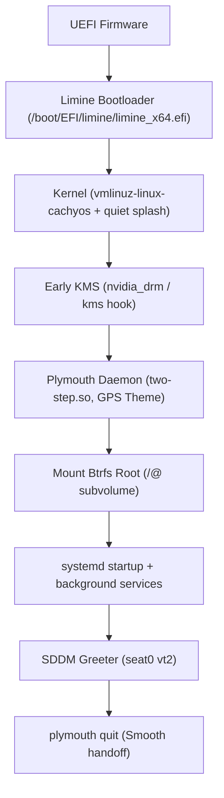

# GPS Desktop — Plymouth Boot Splash Package (Unapplied)

> [!IMPORTANT]
> **This package is STANDALONE and UNAPPLIED.**
> The active system bootloader, initramfs, and splash screen configurations have NOT been modified. The system continues to use its default theme (`cachyos-bootanimation`) with unedited initramfs images.

---

## 1. System Audit & Host Configuration

An audit of this machine detected the following boot and initramfs configuration:

| Component | Detected Specification | Details |
| :--- | :--- | :--- |
| **Bootloader** | **Limine** `12.9.4` | EFI binary: `/boot/EFI/limine/limine_x64.efi`<br>ESP partition: `/dev/nvme0n1p4` (FAT32, mounted at `/boot`)<br>Config: `/etc/default/limine`, `/etc/limine-entry-tool.conf` |
| **Initramfs Generator** | **mkinitcpio** | Systemd-based initramfs (`base systemd ... sd-vconsole plymouth filesystems sd-btrfs-overlayfs`)<br>Hook integration: `limine-mkinitcpio-hook`, `limine-snapper-sync` |
| **Root Filesystem** | **Btrfs** | Subvolume `/@` on `/dev/nvme0n1p5` (`UUID=6dad7804-64dd-4955-92f0-5ff780264feb`)<br>Mount options: `noatime,compress=zstd:1,ssd` |
| **Snapshot System** | **Snapper** | Config: `root` (`snapperd.service`, `limine-snapper-sync.service`, `snap-pac`)<br>Limine automatically syncs snapshots into boot entries |
| **Disk Encryption** | **None** | No active LUKS devices on root or swap; direct partition mounting |
| **Plymouth Status** | **Installed** | `local/plymouth 26.134.222-5`<br>Native C module `two-step.so` present at `/usr/lib/plymouth/two-step.so`<br>Active theme: `cachyos-bootanimation` |
| **Kernel Command Line** | `quiet nowatchdog splash rw rootflags=subvol=/@ root=UUID=6dad7804-64dd-4955-92f0-5ff780264feb` | `quiet` and `splash` are already configured in `/etc/default/limine` |
| **Display Manager** | **SDDM** | `sddm.service` running on seat0 vt2; transitions smoothly from Plymouth |
| **Display / KMS** | Early KMS active | `kms` hook in mkinitcpio + `MODULES+=(nvidia nvidia_modeset nvidia_uvm nvidia_drm)` |

---

## 2. Boot Flow Analysis & Potential Failure Modes



### Potential Failure Modes & Safeguards:

1. **Kernel Command Line Missing `splash` or `quiet`**:
   - *Failure*: Kernel diagnostic messages overwrite the framebuffer, causing flickering or aborting graphical splash.
   - *Mitigation*: Installer audits kernel parameters and refuses or adds `splash` without duplication. On this machine, both `quiet` and `splash` are already set.

2. **Initramfs Hook Ordering Conflict**:
   - *Failure*: If `plymouth` is placed too late, mode switching happens abruptly; if placed after disk encryption hooks, the user cannot see or enter their passphrase.
   - *Mitigation*: The installer enforces strict ordering:
     - For systemd initramfs: `... kms ... sd-vconsole plymouth [sd-encrypt] filesystems`
     - For udev initramfs: `... udev ... plymouth [encrypt] filesystems`
     - If disk encryption is detected and hook ordering cannot be positively verified, the installer **strictly refuses** to proceed.

3. **Complex Scripting Engine Crashing Early in Boot**:
   - *Failure*: Themes relying on `script.so` (interpreters) can fail if fonts or GPU acceleration are not initialized early.
   - *Mitigation*: The GPS theme uses the compiled, rock-solid native C plugin `two-step.so`. It uses lightweight static PNGs with static palettes, requiring zero GPU shaders.

4. **DRM / Wayland Display Server Contention during Preview**:
   - *Failure*: Calling `plymouth show-splash` from within an active Wayland compositor (Hyprland) causes a DRM Master conflict.
   - *Mitigation*: Previewing is isolated to a Linux virtual console (TTY3) with automated guards in `boot/preview.sh`.

---

## 3. Theme Architecture (`boot/theme/`)

The GPS theme implements the canonical GPS Visual Design System (P4):

- **Background Color**: `#0F131C` (`Theme.surfaceDeep`, 0x0f131c).
- **Brand Accent**: `#2DD4BF` (`Theme.brandAccent`, 0x2dd4bf).
- **Surface Elevation**: `#181B25` (`Theme.surfaceBase`, 0x181b25).
- **Centered Watermark**: 160×160 clean GPS emblem rendered from [`assets/rice-logo.svg`](file:///home/rice/Projects/my-rice/assets/rice-logo.svg) (`watermark.png`).
- **Slim Progress Indicator**: 280×4px slim progress bar at 58% screen height with background `#181B25` and accent `#2DD4BF`.
- **Throbber Indicator**: 24-frame antialiased circular teal indicator (32×32) with graceful alpha falloff.
- **Password Prompt Styling**:
  - `entry.png`: 320×36 rounded input field with `#181B25` surface, 1px `#31353F` border, and teal focus glow.
  - `bullet.png`: 10×10 antialiased circular dot in `#2DD4BF`.
  - `lock.png`: 32×32 padlock glyph in `#57F1DB` / `#181B25`.
  - `capslock.png`: 24×28 warning indicator in amber (`#FFD47B`).
  - `keyboard.png`: 36×36 keyboard glyph in `#DFE2EF`.
- **Static Fallback**: If animation or timer subsystem is disabled, Plymouth displays the static emblem and progress bar without visual corruption.

---

## 4. Prerequisites

1. **Package Verification**:
   Plymouth is already installed on this machine (`local/plymouth 26.134.222-5`).
   If missing on another system:
   ```bash
   sudo pacman -S plymouth
   ```

2. **Dedicated Non-Expiring Snapshot (Snapper)**:
   Always create a dedicated Snapper snapshot before applying any boot modifications:
   ```bash
   sudo snapper -c root create -d "Pre-GPS-boot-splash"
   sudo snapper -c root list
   ```
   > [!IMPORTANT]
   > The host Snapper configuration name is `root` (verified via `snapper list-configs`).
   > We deliberately **omit** any `--cleanup-algorithm` flag (such as `timeline` or `number`). Leaving the cleanup algorithm empty ensures this critical recovery snapshot will **never be automatically purged** by periodic timeline rotation or quota cleanup.

3. **Protection of the Separate `/boot` Partition**:
   > [!WARNING]
   > The root filesystem (`/`) is Btrfs on `/dev/nvme0n1p5`, but `/boot` is a **separate FAT32 ESP partition** on `/dev/nvme0n1p4`.
   > Because Snapper operates strictly at the Btrfs filesystem level, a Snapper root snapshot **does not back up or restore `/boot`**!
   >
   > To guarantee full recovery, `install-splash.sh` independently archives:
   > - `/boot/limine.conf` (and any alternate Limine configurations)
   > - Existing initramfs images from `/boot` (including machine-id directories `/boot/<machine-id>/*/initramfs*`)
   >
   > into `/var/backups/gps-boot/<timestamp>/boot/`. On `--rollback`, these files are restored directly to `/boot`.

---

## 5. Previewing from a Virtual Console (TTY)

To inspect the boot splash without modifying boot files or rebooting:

1. Switch to virtual console 3:
   Press **`Ctrl + Alt + F3`** (or `F4`).
2. Log in with your credentials (`rice` or `root`).
3. Run the preview tool:
   ```bash
   sudo /home/rice/Projects/my-rice/boot/preview.sh
   ```
   Or run the raw Plymouth preview commands manually:
   ```bash
   # 1. Start plymouth daemon in boot mode
   sudo plymouthd --mode=boot --debug --debug-file=/tmp/plymouth-debug.log

   # 2. Show splash screen
   sudo plymouth show-splash

   # 3. Simulate boot status message and progress
   sudo plymouth message --text="Starting GPS Desktop..."
   sudo plymouth update --status="Loading kernel modules..."
   sleep 2

   # 4. Optional: test password prompt dialog
   sudo plymouth ask-for-password --prompt="Passphrase:"

   # 5. Terminate splash
   sudo plymouth quit
   ```
4. Return to your desktop session:
   Press **`Ctrl + Alt + F2`** (or `F1`).

---

## 6. Safe Installation (`boot/install-splash.sh`)

### Step 1: Simulate with Dry-Run (Default)
Verify proposed actions without changing any system file:
```bash
./boot/install-splash.sh --dry-run
```

### Step 2: Apply
When you are ready to install the package and activate the theme:
```bash
sudo ./boot/install-splash.sh --apply
```

What `--apply` executes:
1. **System Invariant Validation**: Verifies Plymouth installation, `two-step.so` module, source theme files, verified Limine integration (`limine-mkinitcpio`), and encryption hook ordering.
2. **Phase A (Backup & Pre-apply Inventory)**:
   - Takes a complete inventory of all files present on the separate `/boot` partition.
   - Archives any pre-existing GPS theme in `/usr/share/plymouth/themes/gps/`.
   - Archives system configurations (`/etc/plymouth/plymouthd.conf`, `/etc/mkinitcpio.conf`, `/etc/default/limine`, `/etc/default/grub`).
   - Archives all supported Limine configs (`/boot/limine.conf`, etc.) and all existing binary initramfs images from `/boot/`.
3. **Phase B (Verify)**:
   - Validates that every backed up file exists, is readable, and non-empty.
   - Writes and validates the restoration `manifest.json`.
   - Updates the `/var/backups/gps-boot/latest` pointer only after verification succeeds.
   - If any verification check fails, apply aborts before changing a single system file.
4. **Phase C (Apply Modifications)**:
   - Arms an automatic emergency rollback trap (`trap cleanup_on_apply_failure ERR`).
   - Updates `/etc/plymouth/plymouthd.conf` with `[Daemon] Theme=gps`.
   - Cleans and installs the theme package to `/usr/share/plymouth/themes/gps/`.
   - Injects the `plymouth` hook into `/etc/mkinitcpio.conf` if not present.
   - Adds `splash` kernel parameter if missing.
   - Regenerates initramfs and synchronizes Limine boot entries via `sudo limine-mkinitcpio`.
   - Disarms the emergency rollback trap upon successful completion.

### Step 3: Verify Installation
```bash
./boot/install-splash.sh --status
plymouth-set-default-theme
```
Expected output: `gps`.

---

## 7. Rollback Procedure

To completely revert the system to its previous state:

```bash
sudo ./boot/install-splash.sh --rollback
```

To roll back to a specific timestamped backup archive:
```bash
sudo ./boot/install-splash.sh --rollback /var/backups/gps-boot/20261030_XXXXXX
```

What rollback executes:
1. Restores the original `/etc/plymouth/plymouthd.conf` (re-activating `cachyos-bootanimation`).
2. Restores `/etc/mkinitcpio.conf` if it was modified.
3. Restores bootloader configuration in `/etc/default/limine` and `/etc/default/grub` if modified.
4. Restores `/boot/limine.conf` and the exact original binary initramfs images directly on the separate `/boot` partition.
5. Prunes any new boot artifacts created during apply that were not in the pre-apply inventory.
6. Restores the pre-existing GPS theme if one existed before apply, or removes `/usr/share/plymouth/themes/gps/`.
7. **Purely Restorative Guarantee**: The verified bit-for-bit binary images and bootloader configurations are restored directly from backup. `limine-mkinitcpio` is **never executed during rollback**, eliminating any compiler, packaging, or hook failure risk during recovery.

---

## 8. Emergency Recovery (Live USB & chroot)

If the system ever fails to boot into the graphical desktop:

### Method A: Boot via Snapper Snapshot (Easiest)
Limine automatically synchronizes Snapper snapshots into its boot menu:
1. Reboot the machine.
2. In the Limine bootloader menu, select **Snapshots**.
3. Select the snapshot created prior to applying the splash (e.g. `Pre-GPS-boot-splash`).
4. Boot into the snapshot and run:
   ```bash
   sudo snapper rollback
   sudo reboot
   ```

### Method B: Live USB Recovery via `arch-chroot`
1. Boot any Arch Linux or CachyOS live USB.
2. Mount the root Btrfs subvolume and separate `/boot` partition:
   ```bash
   mount -o subvol=/@ /dev/nvme0n1p5 /mnt
   mount /dev/nvme0n1p4 /mnt/boot
   arch-chroot /mnt
   ```
3. Revert Plymouth theme and regenerate images:
   ```bash
   plymouth-set-default-theme cachyos-bootanimation
   limine-mkinitcpio
   ```
   Or restore from the latest backup:
   ```bash
   /home/rice/Projects/my-rice/boot/install-splash.sh --rollback
   ```
4. Exit and reboot:
   ```bash
   exit
   umount -R /mnt
   reboot
   ```

---

## 9. Lower-Risk Alternative: Silent Clean Boot

If you prefer maximum simplicity, faster boot times, and zero splash screen complexity, you can achieve a completely clean silent boot **without Plymouth**:

1. Remove or do not add the `plymouth` hook in `/etc/mkinitcpio.conf`.
2. Configure kernel command line in `/etc/default/limine`:
   ```bash
   KERNEL_CMDLINE[default]+="quiet loglevel=3 rd.udev.log_priority=3 vt.global_cursor_default=0"
   ```
3. Regenerate initramfs and sync Limine entries:
   ```bash
   sudo limine-mkinitcpio
   ```

This suppresses all kernel boot logs, leaving the screen clean and black until the SDDM greeter appears, with zero overhead and zero risk of splash hang.
